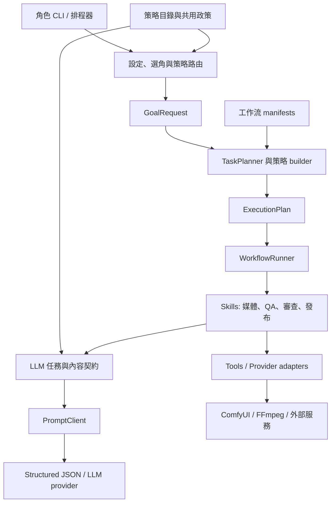

# 架構與擴充指南

MediaOverload 的執行核心是「設定／目標 → 明確計畫 → 技能 → 工具／供應商 → 媒體 QA → 人工審查 → 發布」。策略決定產品流程，模型決定某一階如何生成，LLM 負責內容與路由建議。三者要分開變更。

## 責任與依賴方向

| 模組 | 擁有的責任 | 不應放進來的責任 |
|---|---|---|
| `app/character_config.py` | 設定載入與正規化 | 生成 graph、LLM 提示 |
| `app/character_selection.py` | 角色群組與 concrete subject context | 模型工作流選取 |
| `app/generation_routing.py` | 策略／工作流候選、權重與政策解析 | 渲染、發布 |
| `app/character_payload.py` | 已解析設定轉為 goal 約束 | 工具執行 |
| `app/character_workflow.py` | 一次角色工作的協調與結果 | 各策略節點細節 |
| `runtime/strategies.py` | 策略語意、媒體型別、共用數量政策 | 讀 YAML、呼叫 provider |
| `runtime/planner.py` | 明確 builder dispatch | 長篇提示、工具 transport |
| `runtime/planning/` | 各流程的節點、順序與輸入 | 真正生成與 API 呼叫 |
| `runtime/llm_engine.py` | 應用可呼叫的任務 API | 各文案 schema 與 prompt 細節 |
| `runtime/prompt_tasks/` | 任務提示、schema、內容驗證 | API client、平台派送 |
| `runtime/llm_client.py`, `llm_config.py` | 共用 manager、供應商設定、來源記錄 | 猜測任務名稱或內容語言 |
| `runtime/structured_chat.py` | JSON 解析、有限修正、期限與記錄 | 新聞、字卡、H3 的內容規則 |
| `skills/` | 使用 state 執行一個產品能力 | 選擇全域策略 |
| `tools/` 與 provider adapter | 外部系統與檔案契約 | 人工審查政策 |

依賴應由 app 指向 runtime，策略 builder 指向 contracts／共用 planning context。Prompt 任務透過共用 client；client 不匯入任務。不要讓通用 JSON 呼叫按 schema 名稱選英文、中文或故事規則：呼叫端明確提供語言與驗證契約。

## 哪些共用，哪些分開

| 能力 | 共用位置 | 分開的部分與原因 |
|---|---|---|
| 策略身分與數量政策 | `strategies.py` | YAML 保留角色可用候選與權重，避免角色差異變成硬編碼 |
| manifest 選取、畫布、播放倍率、review 與 native 成片後段 | `planning/common.py` | 各 builder 擁有實際節點與依賴，conditioning 不同時不能混成一個巨大開關 |
| Native H3 故事與提示 | `prompt_tasks/native_h3.py`、`storyboard.py`、`minimax_prompting.py` | T2VA、首幀、尾幀、首尾幀、Ref2VA 各自保留輸入與審查契約 |
| JSON transport、repair、provider 與 recorder | `structured_chat.py`、`llm_client.py`、`model_backends.py` | Story Card、場景、sprite、發布文案各自擁有 schema、語言與內容驗證 |
| 媒體路徑、QA、編輯與發布派送 | 既有媒體工具、shared skills、publishing adapter | 原生音訊、字卡精確排字、sprite 透明圖集等各自擁有產物契約 |
| 平台文案格式 | `platform_content.py` | 通用 LLM 作者不處理 Facebook／Instagram 等平台輸出細節 |

判斷是否共用，要看輸入、輸出、不變條件與失敗處理是否一致。只有幾行相似或名稱相近，不能當作共用理由。若兩個策略共享同一產品行為，就呼叫同一 helper 或 builder；只有 conditioning 或產物契約不同的部分留在策略內。

目前沒有動態 plugin 掃描、策略 class 繼承樹或通用 pipeline DSL。使用明確 registry、普通函式與既有節點契約，新增流程時能看見全部依賴。不得因為預期策略會增加，先加沒有使用者的 framework。

## 新增生成策略

1. 先寫 `User Given / When / Then` 情境，定義入口、需要的素材、可見產物、人工審查與失敗結果。
2. 在 `strategies.py` 註冊產品策略與媒體型別；僅新增 metadata 能表達的語意。策略不知道模型供應商。
3. 若 graph 行為已相同，重用現有 builder；若確有新節點／conditioning 順序，在 `planning/` 增加對應 builder，並在 `planner.PLAN_BUILDERS` 明確登記。
4. 在 `configs/routing.yaml` 加策略候選、階段工作流與適用數量；角色特有設定留在角色 YAML。共用數量規則不可再複製到路由與 LLM 作者。
5. 若需要新內容契約，在 `prompt_tasks/` 加任務與公開 LLM API；直接重用 `PromptClient.generate_json`，明確傳入語言與驗證規則。新產品能力才增加 skill；已有能力就組合現有 skill。
6. 用真實 manifest／技能註冊驗證完整 DAG，再在可用的真實 renderer 上驗收。圖可執行、影片可播放與故事品質是三種不同證據。

未知策略與明確指定的不存在／不相容工作流會直接失敗，避免錯誤設定被替換成其他模型。角色尚未配置的能力不應出現在候選池。

## 新增生成模型

如果新模型仍是相同的圖片或影片輸入契約，新增 `configs/workflow/` 定義與資產 metadata，再放進相應階段候選即可，不必新建產品策略。

- ComfyUI 模型使用既有 workflow tool；manifest 描述媒體型別、conditioning、預設畫布與必要資產。
- H3 圖片與影片透過同一個 ComfyUI 服務執行；reference、opening 和 ending 的輸入契約仍由各策略保留，不能互換。
- 只有新執行協定或新的素材契約，才增加 tool／adapter；對外仍回傳現有媒體產物與 lineage／QA 可消費的結果。
- 不把模型名稱塞進 app 的選角、發布或通用 JSON transport。不得以 silent fallback 替代缺失 conditioning。

## 新增 LLM

同一 provider 的新型號只更改文字／視覺模型設定或其候選池。OpenAI-compatible provider 重用既有 adapter 與 provider spec。新增不同協定時，實作 `model_backends.ChatModel` 的 `chat_completion(messages, images, **options) -> str` 契約，再由 manager factory 組裝；不得複製任務 prompts 或整個 LLM 引擎。

模型協定測試使用本機 HTTP server，驗證請求與錯誤回應。內容驗收在模型邊界注入明確的 ChatModel 替身，仍經過真正的 JSON transport、任務 schema 與內容檢查。新聞故事與字卡在 LLM 不可用時直接失敗，不可用無關罐頭內容冒充生成結果。

## 維護規則與驗證邊界

- 每一責任只保留一個來源：Python 套件依賴在 `pyproject.toml`、策略語意在 `strategies.py`、模型輸入在 manifest／adapter、內容契約在對應任務。
- 刪除舊能力時追查入口、註冊、設定、測試與文件引用。移除停止使用的 downloader、假產物 demo、一次性 A/B 腳本與過時研究說明；保留共享且仍有實際消費者的 storyboard／prompt 驗證器。
- 模型資產由各模型環境安裝，應用只檢查 readiness。缺失資產回報 `missing / manual_setup`，大小不符回報 `corrupt / redownload`；沒有下載器的功能不得宣告 `scheduled` 或提供自動下載選項。
- README 只放操作入口與導覽；架構、模型安裝、編輯寫作指南各自維護。不要在不同文件複製整份策略清單或歷史實測結果。
- 本機端到端驗收使用真正的 `build_runtime`、planner、runner、FFmpeg、ffprobe，完成編輯與媒體 QA。計畫契約另外驗證所有已配置策略的 DAG、技能與工具。
- 分支覆蓋率以 90% 為診斷目標；先補有產品意義的錯誤路徑，不為數字增加 private-method 或 call-count 斷言。
- 尚需補強的內容分支包括 H3 的可選欄位／供應商回覆正規化、motion graphics 作者與審稿結果，以及路由政策修正。這些可用公開模型契約的代表性回覆驗證；GPU 與發布驗收是另外的邊界，不能拿來解釋所有本機覆蓋缺口。
- 外部 DB、LLM、ComfyUI、GPU、Discord 與社群發布需要獨立驗收。不得以本機通過或歷史成片宣稱現行外部流程已通過。

仍需留意的維護成本是長片多階連續性、Native H3 候選審查與角色路由設定合併。這些流程本身包含不同業務規則，應保持有名稱的局部函式與情境測試；未出現共用契約前，不再抽象成另一層通用引擎。
