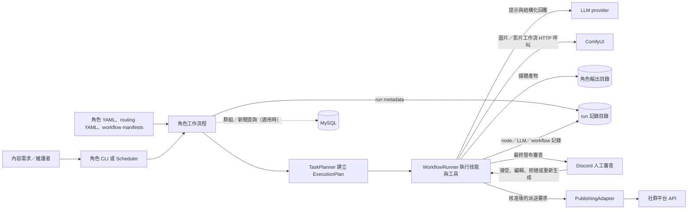

# MediaOverload 工程師接手指南

> **閱讀對象：** 新加入的維護者；本指南帶你從一筆媒體需求追到產物、審查與發布邊界。
>
> **文件負責角色：** repo 維護者（repo 未列出具名負責人或值班窗口）　**來源核對：** 2026-10-17，`main` HEAD `c232e9a` 加上當時的本機未提交變更　**範圍：** 此 checkout 的角色生成與 Agentic 執行路徑；不是正式環境 runbook。

## 先從這裡開始

MediaOverload 幫內容製作者把角色、使用者目標和生成限制轉成圖片或影片，接著執行技術檢查、需要的人工審查，以及可選的社群發布。若生成失敗，使用者拿不到可用媒體；若發布派送狀態不明，外部平台可能已有部分副作用，不能只看頂層狀態就重送。

最安全的第一步是執行 `python run_media_interface.py --help` 查看[角色介面入口程式](../run_media_interface.py)提供的選項，或在依 README 安裝後執行只產生計畫的 Agentic CLI 範例。`agentic --goal "A hero catches a falling seed" --media-type image` 沒有 `--execute`，只輸出計畫，不會啟動生成。第一次熟悉系統時不要啟動排程器；它會持續檢查並觸發工作。

讀完後，你應能追一筆工作從 CLI／排程設定到產物，找到失敗節點與相關證據，並知道哪些步驟會呼叫外部服務。這份指南只說明如何理解和定位；正式操作、重送、復原與權限流程需由 repo owner 補上並核准。

| 你現在要…… | 直接前往…… |
|---|---|
| 安全熟悉入口與本機前提 | [第一條安全上手路徑](#第一條安全上手路徑) |
| 追查一筆卡住或失敗的 run | [如何判斷一筆 run 到了哪裡](#如何判斷一筆-run-到了哪裡) |
| 修改策略、節點或外部整合 | [要改動時，先回到責任來源](#要改動時先回到責任來源) |

### 第一條安全上手路徑

1. **確認 checkout 狀態：** 執行 `git status --short --branch`。本指南寫作時 `main` 上有 README、H3 提示／路由／runtime、測試與 H3 文件的未提交修改；先辨認並保留既有工作，不要將這份文件的來源狀態當成乾淨發布版本。
2. **確認本機前提：** README 要求 Python 3.11 以上；媒體流程需要 `ffmpeg` 與 `ffprobe` 可從 PATH 執行。套件依賴由 [agentic/pyproject.toml](../agentic/pyproject.toml) 維護，設定與工作流則從 repo checkout 的 `configs/` 讀取。
3. **先看計畫：** 安裝後使用 README 的 `agentic` 計畫範例，不加 `--execute`。確認輸入目標、媒體型別、選到的策略／工作流與節點後再考慮受控生成。
4. **開始真實生成前：** 確認已由專案負責人提供核准的模型、ComfyUI、資料庫及 Discord 設定。若只想生成而不發布，角色入口可用 `--no-publish`；它仍會呼叫生成所需的 LLM／ComfyUI，且不代表 Discord 審查一定略過。

憑證範例在 [media_overload.env.example](../media_overload.env.example)。實際 `.env`、`media_overload.env` 與社群憑證設定不應複製進文件、run 記錄或聊天；repo 沒有說明核准申請窗口，請向維護者確認。

## 一筆短片工作如何走到結果

**User / Given / When / Then 情境：** User 有一個角色短片構想，Given 角色設定、路由候選與需要的外部服務都已配置，When 他從 `run_media_interface.py` 提交目標並選擇 `text2image2video`，Then 系統依計畫產生可追蹤的媒體結果；若該次請求也啟用發布，發布流程會另外要求 Discord 人工核准，再進入平台派送。

這條路徑的關鍵是「生成」和「發布」分成兩段。下圖呈現 repo 的責任關係，不是實際部署拓樸；MySQL 只在角色群組／新聞等設定路徑需要時使用，Docker Compose 也沒有把外部服務一併部署。

**如何讀圖：** 入口與 YAML 設定決定目標和候選策略；planner 將目標編成節點有依賴順序的計畫；runner 執行技能，技能再呼叫 LLM、ComfyUI 或媒體工具。媒體檔寫到輸出目錄，run 證據寫到 `logs/runs/`。發布若啟用，角色流程在生成工作流成功後另建 `publish_review` 工作流；Discord 的最終審查結果才會放行發布 adapter。圖中的 Discord 來回箭頭代表審查請求和使用者決策，不代表所有策略都會有相同的中途審查節點。

實作入口依序是 [run_media_interface.py](../run_media_interface.py) → [character_session.py](../agentic/src/agentic/app/character_session.py) → [character_workflow.py](../agentic/src/agentic/app/character_workflow.py) → [planner.py](../agentic/src/agentic/runtime/planner.py) → [runner.py](../agentic/src/agentic/runtime/runner.py)。短片節點在 [planning/short_video.py](../agentic/src/agentic/runtime/planning/short_video.py) 組裝；`text2image2video` 的 image、video 工作流候選由 [routing.yaml](../configs/routing.yaml) 與工作流 manifests 一起決定。不同策略會建立不同 DAG，勿把短片範例套到所有媒體型別。

### 走到各步時，接手者要確認什麼

| 步驟 | 系統做什麼 | 先看哪裡、哪個訊號代表什麼 |
|---|---|---|
| 接收需求 | CLI 解析角色／設定路徑、提示、媒體策略、review 與 publish 選項；`character_session` 開啟可重新生成的角色工作階段。 | [角色設定](../configs/characters/) 決定角色、群組與生成偏好；[CLI](../run_media_interface.py) 是手動入口。排程入口在 [scheduler.py](../scheduler/scheduler.py)。 |
| 選擇內容與策略 | 角色流程讀設定、解析選角與生成路由，再建立 `GoalRequest`。新聞／角色群組使用 MySQL 的路徑依設定而定。 | 策略語意看 [strategies.py](../agentic/src/agentic/runtime/strategies.py)，角色可用候選與權重看 `configs/routing.yaml`。未找到候選或設定不相容時，先確認設定；不要假設系統會安全地改用另一個模型。 |
| 建立並執行計畫 | `TaskPlanner` 用明確 registry 選 builder；`WorkflowRunner` 按依賴順序執行每個 node，失敗時依 runtime retry policy 決定是否再試。 | 查看 `workflow_*.json`、`node.started`／`node.completed` 事件和 `nodes/<node>_attempt_<n>.json`。單一 node 成功不等於整個工作流完成。 |
| QA 與保存產物 | 各策略安排圖片／影片檢查、編輯、預覽或摘要；產物通常在 `output/<character>/`，也可由 `--output-dir` 改寫。 | `run_manifest.json` 的 `artifacts` 與 node 輸出提供路徑；開啟實際最終媒體確認內容。技術 QA 通過只支持該項檢查，不等於創意品質或人工審核通過。 |
| 人工審查與發布 | 若角色請求啟用發布，生成成功且有可發布媒體及平台設定後，角色流程會建立獨立 `publish_review` 計畫。最終媒體審查需要 Discord 人工決定；拒絕或重新生成會阻止本輪後續派送。 | [agent_social.py](../agentic/src/agentic/skills/agent_social.py) 與 [context_services.py](../agentic/src/agentic/tools/context_services.py) 定義 Discord 決策和必要審核行為；平台派送由 [publishing_adapter.py](../agentic/src/agentic/tools/publishing_adapter.py) 負責。檢查每個平台的結果／receipt，不能只看一個 `success` 字串。 |

## 如何判斷一筆 run 到了哪裡

角色工作流程會為每次執行建立 `logs/runs/<run_id>/`。這些路徑被 `.gitignore` 排除，是本機執行證據，不會隨 Git 一起版控。從 CLI 結果取得 `run_id`，再按下列順序追查：

1. **`run_manifest.json`：** 看最終 `status`、`failure_node`／`failure_skill`、`failure_reason`、`stage_status` 與產物路徑。整體 `failed` 可能發生在生成之後，例如發布階段失敗。
2. **`events.jsonl`：** 依時間找最後一個 `node.started`、對應 `node.completed`、LLM call 與 `run.finalized`，確認失敗落在哪一段。
3. **`nodes/<node>_attempt_<n>.json`：** 查該 node 的狀態、輸出、metrics 和 logs。若失敗有重試，逐一看 attempt。
4. **`workflow_*.json`：** 比較生成與 `publish_review` 各自的計畫和結果，勿把兩段合併成單一成功訊號。
5. **`llm/*.json`：** 只在 LLM 相關 node 需要時查看。這些檔案會保存 prompt messages、schema、raw response 和錯誤；內容可能含使用者提示、來源資訊或個人路徑，分享前先檢查並遮蔽。
6. **輸出檔案：** 依 manifest／node 提供的路徑檢查最後媒體。圖片／影片的存在、可解碼、QA 結果和人工觀感是不同證據。

**本機觀察案例（2026-10-17）：** run `ed8805c51ea4` 的生成工作流完成、`render` 與 `review` stage 顯示成功，但整體 run 在 `dispatch-publish` 失敗。該 node 的輸出同時記錄 `publication_state=partially_published`、`publicly_visible=false`，並有 YouTube 平台錯誤。這個記錄不足以判定外部平台是否已有副作用；遇到相似狀態時，先對照 node 的 per-platform `results`、`errors` 和 `publish_receipts`，再確認平台端結果。確認前不要重送，以免重複派送。此 run 位於被忽略的本機 `logs/`，後續 checkout 未必留有它。

`stage_status.review=success` 只表示該計畫中的 review node 完成；某些中途選片可由自動流程完成，不等於最終 Discord 發布核准。對發布核准要看 `publish_review` 的 `review-select` node、`review_mode`／review session，以及 `dispatch-publish` 的平台結果與 receipt。

## 看到異常時先做什麼

| 看到什麼 | 先查什麼 | 安全的下一步／停止點 |
|---|---|---|
| 找不到角色或工作流 | CLI 回傳的 config path、角色 YAML、`routing.yaml` 候選與 workflow manifest 名稱。 | 修正設定前先確認目標策略與工作流相容；不要臨時換成別的候選來繞過錯誤。 |
| 在 `ensure_workflow`／asset check 失敗 | 對應 node log、manifest 的必要模型資產、ComfyUI host／port／root。 | 該檢查只回報資產 readiness；資產安裝方式由模型環境負責，repo 未提供通用自動下載／復原流程。缺資產時先找模型環境負責者。 |
| 生成有產物但整體 run 顯示 failed | manifest 的 `stage_status`、最終失敗 node，以及 `workflow_*.json`。 | 先分清生成與後續發布階段；不要因已有影片就推定發布成功或失敗。 |
| 發布顯示 partial、unknown 或平台錯誤 | `dispatch-publish` node 的 per-platform 結果和 receipts，必要時到相應平台核對。 | 如果派送已開始但平台結果不確定，先停止重送。repo 未附已驗證的發布復原 runbook 或值班窗口；找 repo／平台負責人確認外部狀態與核准處置。 |
| H3 在 prompt／story node 失敗 | 該 run 的 manifest、對應 node 與 `llm/*.json`；再對照 [H3 提示契約](minimax_h3_prompting.md) 和 [ComfyUI H3 輸入契約](comfyui_h3.md)。 | 這個 checkout 的 H3 提示格式、runtime、測試與相關文件有未提交修改。2026-10-17 已知修訂移除了部分 prompt 格式拒絕規則並正規化結構化 camera 內容，但尚無該修訂後的測試或新 ComfyUI／GPU 成片證據；不要把錯誤消失推定為已驗收。 |
| 影片可播放但看起來不符合故事或動作需求 | 最終影片、代表影格／接觸表、QA 輸出和 storyboard／prompt lineage。 | 播放成功與動作／故事品質是不同驗收；沒有看過最終素材前，不要宣稱視覺品質通過。 |

repo 文件沒有找到正式 production runbook、事故升級窗口、部署核准流程或外部服務負責人名單。這些資訊需要由 repo owner 補齊；在此之前，正式環境的重送、刪除、回滾、憑證操作與排程重啟都應停下來確認。README 也特別提醒，不要為測試重啟正在執行的生成工作。

## 要改動時，先回到責任來源

| 想改哪裡 | 從哪個來源開始 | 變更會影響什麼 |
|---|---|---|
| CLI、角色選擇或請求組裝 | [run_media_interface.py](../run_media_interface.py)、`app/character_*` | 可見參數、角色設定與下游 goal 約束。 |
| 策略語意或路由候選 | [strategies.py](../agentic/src/agentic/runtime/strategies.py)、[routing.yaml](../configs/routing.yaml)、`runtime/planner.py` | 可選生成方式、工作流相容性、數量／審查政策。 |
| 節點順序與產物條件 | `runtime/planning/<strategy>.py`、[runtime/contracts.py](../agentic/src/agentic/runtime/contracts.py) | DAG 依賴、技能輸入和輸出、重試時的失敗邊界。 |
| 模型工作流或資產需求 | [configs/workflow](../configs/workflow/)、[assets/registry.py](../agentic/src/agentic/assets/registry.py) | ComfyUI graph、conditioning、資產 readiness 與最後媒體。 |
| LLM 任務內容或格式 | [runtime/prompt_tasks](../agentic/src/agentic/runtime/prompt_tasks/)、[structured_chat.py](../agentic/src/agentic/runtime/structured_chat.py) | prompt、JSON schema、內容驗證和 provider 邊界。 |
| 媒體 QA、Discord 或社群發布 | `runtime/planning/`、[agent_social.py](../agentic/src/agentic/skills/agent_social.py)、[publishing_adapter.py](../agentic/src/agentic/tools/publishing_adapter.py) | 人工核准條件、最終媒體包裝與外部副作用。 |

完整責任劃分與新增策略、模型和 LLM 的維護規則見[架構與擴充指南](architecture.md)。新增或更改使用者可見行為時，先依 repo 規則寫 `User Given / When / Then` 驗收情境，再實作；測試要驗證公開行為與契約。

## 本機檢查與外部驗收的界線

[README 驗證章節](../README.md#驗證) 提供 ruff、本機 pytest 和 integration 測試收集命令；本 repo 未包含 CI workflow。計畫／契約檢查能說明程式是否建出可連接的 DAG，不能證明外部服務、GPU 渲染、最終影片品質、Discord 核准或社群派送在目前環境成功。

本次撰寫指南沒有執行 pytest、CI、ComfyUI、GPU 或社群端到端驗收。H3 修改在本機工作樹仍未提交；上一輪記錄也標示該修改後未跑測試或新 render。需要宣稱 H3 修復已完成時，應依接受文件覆蓋 T2VA、Ref2VA、I2VA，並檢查新的最終產物與相關 run 證據。

## 交接未完成項目

- **維護者走讀：尚未驗證。** 請一位未參與撰寫的人用一筆短片請求走讀計畫、找到一個 run 的失敗 node，並說明在 partial publish 時為何不能直接重送；記下卡點後更新本指南。
- **正式操作資料：待確認。** 指定 repo owner／值班窗口，補上核准的部署、發布對帳、重送／復原與憑證申請 runbook。
- **保留與刪除：待確認。** run logs 包含 prompt 與 provider 回覆，repo 未記載其本機／主機保留時間；先視為需要控管的內容，不要假設忽略的資料會自動清除。
- **文件更新責任：** 由 repo 維護者在策略、設定、review gate、run 記錄格式或外部依賴改變時更新；姓名與更新時限尚未在 repo 確認。

## 延伸閱讀

- [專案 README：安裝、入口、設定與驗證](../README.md)
- [架構與擴充指南](architecture.md)
- [ComfyUI H3 工作流與輸入契約](comfyui_h3.md)
- [H3 提示契約](minimax_h3_prompting.md)
- [NVIDIA VFX 後處理操作說明](comfyui_nvidia_vfx_postprocess.md)
- [本機環境變數範例](../media_overload.env.example)
