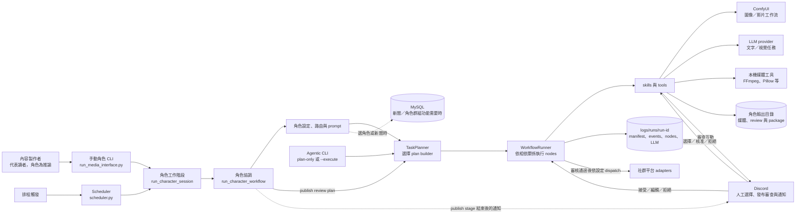
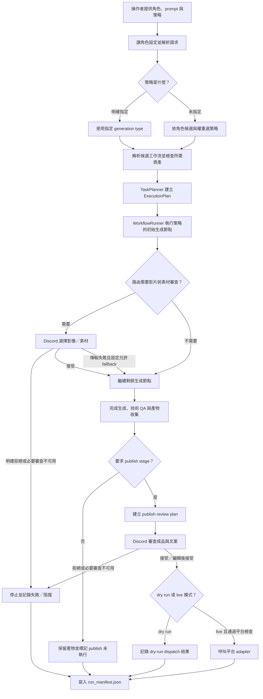

# 核心流程與系統責任

[回到工程交接入口](index.md)。本頁依 `a113252cebf41f3e9fa399337914a26c99e1cd4b` 說明角色 CLI、排程、Agentic 執行器和外部服務之間的責任。圖中的內容是程式結構與設定推導，不代表目前已部署或正在運作的環境。

## 兩種入口各自負責什麼

手動角色入口 `run_media_interface.py` 和 `scheduler/scheduler.py` 都建立 `CharacterWorkflowRequest`，再進入 `run_character_session()`。角色工作階段可以因 Discord 的「重新生成」要求，保留舊 run 記錄並重新跑一個新的完整 run。排程入口負責讀排程設定、建立請求和觸發工作；它不提供另一套生成流程。

直接 `agentic` CLI 從目標建立 `GoalRequest`，由 planner 選計畫、runner 執行節點。沒有 `--execute` 時，CLI 在列印 plan 後返回；加上 `--execute` 才執行，分支可在 [`agentic/app/main.py`](../../agentic/src/agentic/app/main.py#L265) 核對。它適合直接使用圖片、影片、編輯或 publish/review 工作流，不能把它的 plan-only 結果視為角色流程的審查或發布結果。

## 元件地圖：每個部分在哪裡接手

這張圖回答「哪一層負責哪個結果」：角色入口和排程只整理請求；[`character_payload`](../../agentic/src/agentic/app/character_payload.py#L65) 將角色設定、生成策略和 runtime 條件變成 planner 的 goal；`TaskPlanner` 選擇 plan builder；`WorkflowRunner` 依 plan 節點的相依順序呼叫 skill/tool。媒體工作流透過 ComfyUI 執行，LLM 和本機媒體處理只在該路徑需要時參與。[`NewsContextService` 與角色群組服務](../../agentic/src/agentic/tools/context_services.py#L63) 會在新聞選取或群組角色選取等條件功能使用 MySQL，不代表每次生成都會連線。各次 run 的結果和診斷資料另外由 `RunRecorder` 寫入 `logs/runs/<run_id>/`。

角色入口和排程的責任可從 [`run_media_interface.py`](../../run_media_interface.py#L48)、[`character_session.py`](../../agentic/src/agentic/app/character_session.py#L14) 與 [`scheduler.py`](../../scheduler/scheduler.py#L144) 追查；角色協調、planner 與 runner 分別見 [`character_workflow.py`](../../agentic/src/agentic/app/character_workflow.py#L89)、[`planner.py`](../../agentic/src/agentic/runtime/planner.py#L62) 和 [`runner.py`](../../agentic/src/agentic/runtime/runner.py#L16)。

## 一筆請求怎麼走到結果

以下是代表情境，不是某個已執行的 run：內容製作者想讓 Kirby 接住一顆滑落的星星，指定 `text2image2video`，並要求先走發布 dry run。這個例子沿用 repo README 的入口形式；它說明程式路徑，不證明 GPU、LLM、Discord 或平台服務已完成驗收。

主路徑先決定要做哪種媒體，再挑符合輸入契約的 ComfyUI workflow，執行生成和技術檢查。部分影片策略會先產生候選影像，讓審查者挑選後才把選定素材交給影片節點。最後若角色設定與請求要求 publish stage，系統會再建立獨立的 publish/review plan；生成審查的 Accept 不等於成品發布核准。

### 影響輸出的幾個概念

- **generation type（生成策略）**決定「要完成哪種媒體流程」，例如 `text2image2video`、`native_h3_story` 或 `motion_comic`。角色設定提供可用候選和權重；手動 CLI 的 `--generation-type` 可指定策略。它不是 ComfyUI workflow 的檔名。
- **ComfyUI workflow**描述某個生成節點使用的模型、影像／影片條件輸入和保存節點；路由設定先篩選適用候選，資產檢查後再交給 plan。Workflow JSON 和模型資產變更可能改變結果或使節點無法執行。
- **角色設定**連結角色／群組、創作設定、生成策略和發布平台設定。Kirby 是 repo 內的具體角色 pack；它的主體選擇與路由不代表所有角色共用相同設定。見 [`configs/characters/kirby.yaml`](../../configs/characters/kirby.yaml) 和 [`configs/routing.yaml`](../../configs/routing.yaml)。
- **plan node**代表一次可觀察的工作步驟，例如產生圖片、檢查影片或要求 Discord 選擇。Runner 依 plan 的相依關係執行；第一個失敗節點通常是追查失敗的好起點，見 [`runner.py`](../../agentic/src/agentic/runtime/runner.py#L33)。

### 兩道審查關卡

1. **生成中的素材審查。** `configs/routing.yaml` 為支援的 image-conditioned video 路徑啟用前置審查；預設建立六張候選圖，首幀路徑選一張，Ref2VA 路徑可選多張。明確 Reject 會停止後續工作。設定的 `fallback_to_top` 僅在審查傳輸／逾時失敗時讓路由回到最高排序候選；必要的人工作業無法啟動時會阻擋，不代表審查通過。數量和路徑可從 [`routing.yaml`](../../configs/routing.yaml#L24)、[`text2image2video` plan builder](../../agentic/src/agentic/runtime/planning/short_video.py#L9) 與 [`agent_social.py`](../../agentic/src/agentic/skills/agent_social.py#L471) 核對。
2. **成品發布審查。** 角色工作流進入 publish stage 後，程式明確要求人工審查，之後才 dispatch。成品審查會看到媒體及準備的文案／hashtags；Accept 或 Edit 後接受才繼續，Reject 停止發布。必要 Discord 審查不可用會阻擋這個關卡。這一路徑由 [`character_workflow.py`](../../agentic/src/agentic/app/character_workflow.py#L263) 建立，並由 [`agent_social.py`](../../agentic/src/agentic/skills/agent_social.py#L414) 執行審查與 dispatch。

`--no-publish` 只略過角色工作流的最終 publish stage；它不代表影片生成沒有外部服務或成本。`--dry-run-publish` 把 publish dispatch 設為 dry run，但仍會跑生成、需要的 Discord 審查和 publish plan；參數在 [`run_media_interface.py`](../../run_media_interface.py#L70) 接入並傳給 [`publish review plan`](../../agentic/src/agentic/runtime/planning/publishing.py#L39)。`--stage-probe` 會使用自動選擇測試多階段圖，程式刻意不讓 probe 進入發布；自動選取結果不能當作人工核准或公開發布證明，見 [`_effective_publish_after_generate`](../../agentic/src/agentic/app/character_publishing.py#L209) 與 [`run_media_interface.py`](../../run_media_interface.py#L102)。

### 如何判斷「完成」

外層 JSON 的 `status`、`stage_status.render`、`stage_status.review`、`stage_status.publish` 和 publish 節點的 `publication_state`／`publicly_visible` 各回答不同問題。成功生成不代表最後審查完成；publish stage 成功也不必然代表內容已公開，例如 dry run 或平台的 private/draft/container-only 模式。先看 manifest 的各階段狀態和 dispatch 結果，再向平台本身確認公開狀態；本指南不提供任何線上平台的即時狀態證據。

點回程式來源：角色結果組裝在 [`character_workflow.py`](../../agentic/src/agentic/app/character_workflow.py#L385)，run manifest 的保存格式在 [`observability.py`](../../agentic/src/agentic/runtime/observability.py#L36)，CLI 的執行與 publish 參數在 [`run_media_interface.py`](../../run_media_interface.py#L55)。
